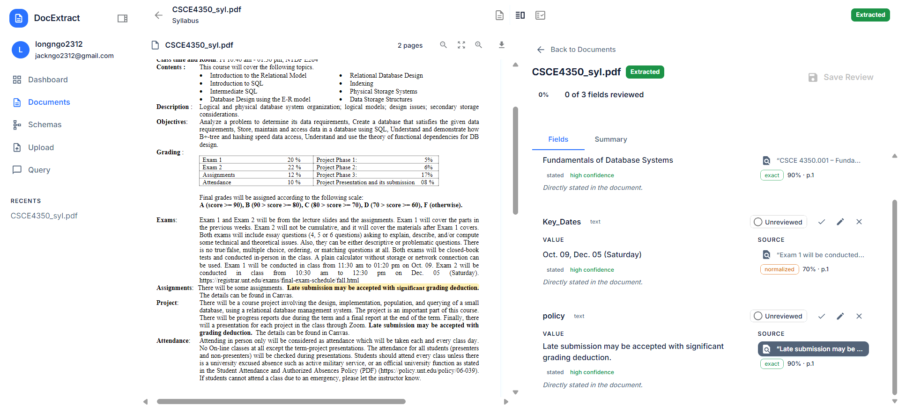
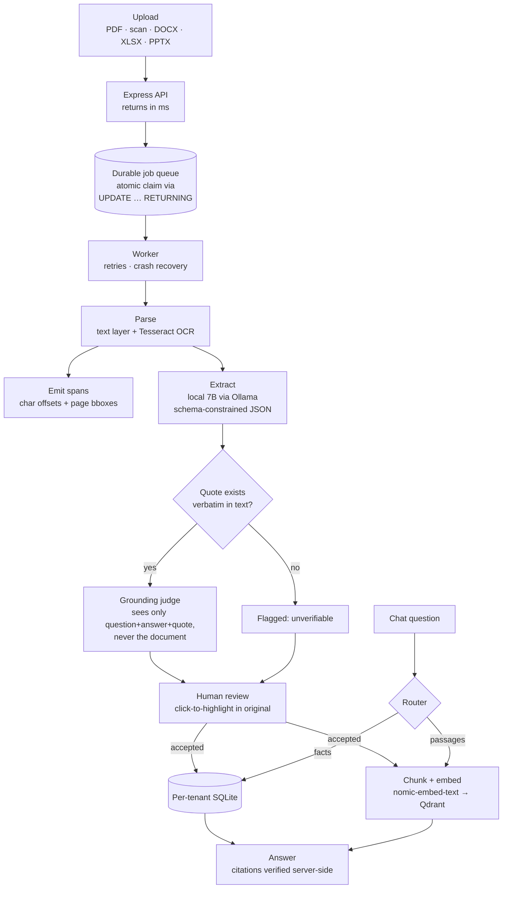
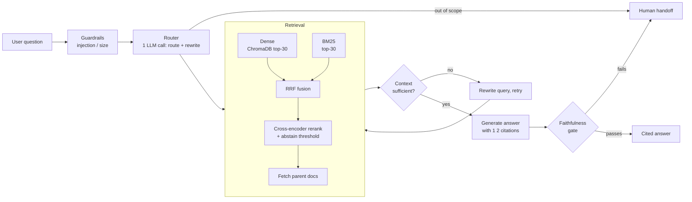

# Jack Ngo

**Backend & Applied-AI Engineering**

- **Focus** — LLM systems that have to be *right*: retrieval grounding, hallucination detection, provenance, evaluation harnesses
- **Also** — multi-tenant backends, async job pipelines, TypeScript / Python / Node APIs
- **Education** — B.S. Computer Science, University of North Texas · Expected 2028
- **Links** — [Portfolio](https://longngo2312.github.io/jackngo-website/) · [LinkedIn](https://www.linkedin.com/in/long-thien-ngo/) · [Resume](resume.pdf) · [jackngo2312@gmail.com](mailto:jackngo2312@gmail.com)

`Python` · `TypeScript` · `Node.js` · `FastAPI` · `Express` · `React` · `LangGraph` · `SQLite` · `PostgreSQL` · `ChromaDB` · `Qdrant` · `Ollama` · `Docker`

---

## ⭐ DocExtract — Document Extraction & Cited Q&A

> Turns PDFs, scans and Office files into structured data for teams whose documents can't leave their network. The model has to cite a verbatim quote for every value it extracts, a person accepts each value before it's indexed, and then you can ask questions across everything that's been reviewed and get cited answers.

**Multi-tenant by construction.** Each user's data lives in its own SQLite file, so data can't leak between tenants through a bad query because they never share one. Ingestion runs behind a durable job queue with single-statement atomic claims, bounded retries, and recovery on startup for jobs a crash left behind. Uploads return in milliseconds even though extraction takes about two minutes. A quantized 7B model runs locally within 6 GB of VRAM: **$0 inference cost per document, and no document leaves the network.**

**Every value is grounded.** Each extracted value carries a verbatim source quote. The server checks that the quote really exists in the parsed text and maps it to character positions and page coordinates, so a reviewer clicks straight to the highlighted passage. A second, separate model then judges whether the quote actually *supports* the answer. It only sees the question, the answer and the quote, never the document, so it can't justify an answer with text that wasn't cited.

**Q&A only over reviewed data.** Nothing reaches the vector index until a human has accepted it. Re-reviewing a document re-indexes it, and deleting one removes its vectors. A router sends each question to SQL over reviewed field values, to vector search over passages, or to both. Every citation is checked on the server before the answer reaches the browser, and if the documents don't cover a question, the assistant says so instead of guessing.

`TypeScript` `Node.js` `Express 5` `SQLite (WAL)` `Ollama` `Qwen2.5-7B` `nomic-embed-text` `Qdrant` `Tesseract OCR` `pdf.js` `React 19` `MUI` `Zustand` `Docker` `nginx`

[**Live demo**](https://docextract-jackngo.dev) · [**Repo**](https://github.com/longngo2312/DocumentExtraction) · [**Design docs**](https://github.com/longngo2312/DocumentExtraction/tree/main/docs)

---

## DotB EMS — Agentic RAG Support Assistant

> Deflects tier-1 support tickets for a Vietnamese education-management SaaS: answers "how do I…" product questions from ~250 pages of mixed Vietnamese/English help documentation, with citations — and hands off to a human instead of guessing.

Built a LangGraph agent over a hybrid retrieval pipeline — dense vector search and BM25 fused with Reciprocal Rank Fusion, then reranked by a local cross-encoder that is allowed to return *nothing*. Every answer passes a faithfulness gate scoring it against its own retrieved context before the user ever sees it; anything below threshold routes to a human rather than shipping a confident guess.

**Measured on a 39-question hand-reviewed golden set** (deliberately including out-of-scope questions where declining is the correct answer):

| Recall@10 | Faithfulness | Answer relevance | Answer correctness |
|:--:|:--:|:--:|:--:|
| **0.97** | **1.00** | 0.97 | 0.93 |

`Python` `LangGraph` `FastAPI` `Google Gemini` `ChromaDB` `BM25` `bge-reranker-v2-m3` `RAGAS-style eval`

[**Repo**](https://github.com/longngo2312/AgenticRagDotB) · [**Architecture & eval notes**](https://github.com/longngo2312/AgenticRagDotB#architecture)<!-- TODO: add · [**Live demo**](url) once deployed -->

---

## MoodMeal

> Helps people with food-triggered symptoms find the pattern their doctor asks about — log meals and symptoms on a calendar, then export the whole history as a PDF to bring to an appointment.

<!-- Record a 5-10s ScreenToGif clip: log a meal → log a symptom → calendar view → export PDF.
     Save it to assets/moodmeal-demo.gif, then delete these two comment lines to un-hide the image. -->
<!-- 

 -->

Cross-platform React Native app on Expo with Supabase for auth, Postgres, and row-level-secured storage of medical history. Meal and symptom entries share a calendar timeline so correlations are visible at a glance, and the whole log exports to a clinician-readable PDF.

`React Native` `Expo` `TypeScript` `Supabase` `PostgreSQL` `React Navigation` `React Native Paper`

[**Repo**](https://github.com/longngo2312/MoodMeal)<!-- TODO: add · [**TestFlight / Expo Go link**](url) -->

---

## Also

| Project | What it is | Stack |
|---|---|---|
| [YouTube Trending VN](https://github.com/longngo2312/YoutubeTrendingVN) | Trending-video dashboard for Vietnam; server-side caching keeps it inside the YouTube API's 10k unit/day free quota and off the client's key | React · Express · MongoDB |
| [Syllabus Scheduler](https://github.com/longngo2312/SyllabusScheduler) | Parses a course syllabus into a semester calendar of assignments and exams | React · Vite |

---

Currently looking for **Summer 2027 SWE internships** — backend, applied AI/ML infrastructure.
